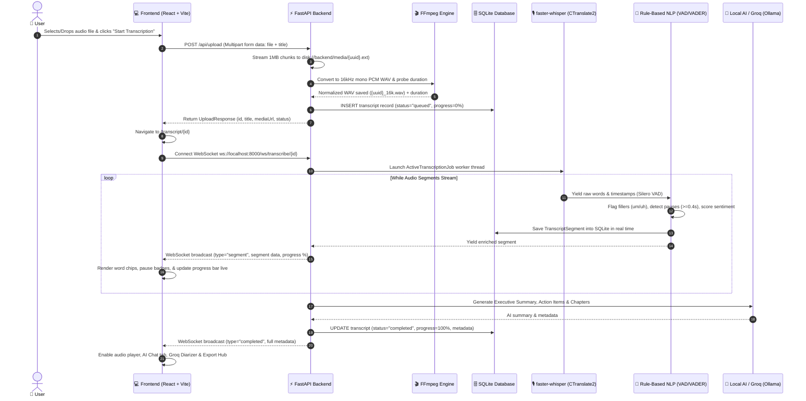

# 🎧 What Happens Once You Upload an Audio File in ClubCut Edit

This document provides a comprehensive, end-to-end breakdown of exactly what happens—both under the hood and on your screen—the moment you upload an audio file to **ClubCut Edit**.

---

## 📌 Executive Summary

When you upload an audio file:
1. **Frontend**: Validates format, attaches an abort controller, and sends the file to the backend.
2. **Backend Storage**: Saves the original file in chunks (`aiofiles`) and generates a unique UUID.
3. **Audio Normalization**: FFmpeg standardizes the audio into a **16kHz mono 16-bit uncompressed PCM WAV** file and probes the exact duration.
4. **Database Record**: SQLite registers the file as `"queued"` with initial metadata.
5. **Progressive Live Streaming**: A WebSocket connection attaches to a background worker thread running **faster-whisper** (CTranslate2 INT8).
6. **Real-time NLP Enrichment**: As words are recognized, regex filler detection, silence pause detection, and VADER sentiment analysis run immediately on every segment.
7. **Incremental Display**: Each segment streams to the browser within seconds—you can read and click words while the rest of the file is still transcribing.
8. **Finalization & AI Insights**: When transcription finishes, Ollama / Local AI generates an **Executive Summary**, **Action Items**, and **Timeline Chapters**.
9. **Interactive Unlocks**: Word-synced audio playback, inline text editing, Groq Cloud speaker diarization, AI conversational Q&A, and multi-format exports (SRT, VTT, TXT, JSON, Markdown) become active.

---

## 🔄 End-to-End Sequence Diagram



---

## 🔍 Detailed Step-by-Step Lifecycle

### Step 1: Pre-Flight Validation & Upload Form (Browser)
- **File Detection**: The drag-and-drop zone accepts audio formats (`.mp3`, `.wav`, `.m4a`, `.aac`, `.flac`, `.ogg`, `.opus`, `.wma`) and video files (`.mp4`, `.webm`, `.mkv`, `.mov`).
- **User Configuration**:
  - **Title**: Automatically parsed from filename (or customized by user).
  - **Processing Mode**: `Quick` (faster STT) or `Deep` (full NLP + diarization).
  - **Speaker Configuration**: `Single Speaker` (solo speech) or `Multiple Speakers` (podcasts/interviews).
  - **Model Size**: `tiny`, `base` (recommended for CPU), `small`, or `medium`.
- **Cancellation Guarantee**: An `AbortController` is attached. If you click **"✕ Cancel Upload"**, the HTTP upload stops immediately with zero lingering resources.

### Step 2: Chunked File Ingestion & Storage (FastAPI)
- **Endpoint**: `POST /api/upload` ([upload.py](file:///d:/Youtube/club_cut_edit/backend/app/routers/upload.py))
- **Memory Safety**: Instead of loading the entire file into RAM, the server streams the file in **1MB chunks** via `aiofiles`. This safely handles gigabyte-sized files on standard consumer machines.
- **File Identity**: A unique UUID v4 (e.g., `4a7b9c1d-8e2f-...`) is assigned to the media file and stored in `backend/media/`.

### Step 3: FFmpeg Audio Extraction & Normalization
- **Module**: `services/media.py` ([media.py](file:///d:/Youtube/club_cut_edit/backend/app/services/media.py))
- **Audio Standardization**:
  FFmpeg converts the input into a clean WAV format with exact parameters:
  ```bash
  ffmpeg -y -i input_file -vn -ar 16000 -ac 1 -c:a pcm_s16le output_16k.wav
  ```
  - `-vn`: Discards video streams (saving 90% disk space & processing time).
  - `-ar 16000`: Resamples to **16,000 Hz** (Whisper’s native input frequency).
  - `-ac 1`: Converts to **mono channel** (eliminates phase cancellation).
  - `-c:a pcm_s16le`: Uncompressed 16-bit PCM (eliminates decoding overhead during AI inference).
- **Duration Probing**: `ffprobe` / `ffmpeg -i` inspects exact file duration in seconds for progress calculation.

### Step 4: Database Registration (SQLite WAL Mode)
- **Table**: `transcripts` ([transcript.py](file:///d:/Youtube/club_cut_edit/backend/app/models/transcript.py))
- Stores the record with:
  - `status`: `"queued"`
  - `progress`: `0.0`
  - `media_filename`: `{file_id}.mp3`
  - `normalized_audio_filename`: `{file_id}_16k.wav`
  - `duration`: e.g. `744.2` seconds
- Returns an immediate JSON response with playback URLs (`/api/media/{filename}`).

### Step 5: Route Navigation & Progressive WebSocket Connection
- **Routing**: The frontend navigates to:
  ```
  /transcript/{id}?mode=deep&speakerMode=multi&model=base
  ```
- **Live Stream Handshake**:
  - `TranscriptPage.tsx` initiates a WebSocket at `ws://localhost:8000/ws/transcribe/{id}`.
  - The backend `TranscriptionManager` ([transcription_manager.py](file:///d:/Youtube/club_cut_edit/backend/app/services/transcription_manager.py)) starts a dedicated background worker thread (`ActiveTranscriptionJob`).

### Step 6: Speech-to-Text with faster-whisper (CTranslate2 INT8)
- **Engine**: `faster-whisper` ([stt.py](file:///d:/Youtube/club_cut_edit/backend/app/services/stt.py))
- **CTranslate2 INT8 Quantization**: Delivers **4x faster processing** on CPU and cuts RAM usage by 50% compared to standard OpenAI Whisper.
- **Silero Voice Activity Detection (VAD)**:
  - Parameter: `min_silence_duration_ms=400`
  - Discards silent audio chunks before neural inference, preventing hallucinated loops and speeding up transcription.
- **Word-Level Timestamps**: Every word receives millisecond-accurate `start`, `end`, and `confidence` probability scores.

### Step 7: Real-Time Rule-Based NLP Enrichment
Before each segment is sent to the database or user, `services/nlp.py` ([nlp.py](file:///d:/Youtube/club_cut_edit/backend/app/services/nlp.py)) enriches it instantly:
1. **Filler Word Analyzer**:
   - Single words: `um`, `uh`, `like`, `actually`, `basically`, `literally`, `er`, `ah`, `hmm`.
   - Multi-word phrases: `"you know"`, `"i mean"`, `"kind of"`, `"sort of"`.
   - Flags words with `isFiller: true` and tallies totals for speech analytics.
2. **Pause & Silence Detection**:
   - Measures gaps between word boundaries (`word[i+1].start - word[i].end`).
   - If gap $\ge 0.40$s, an inline pause marker (`⏸ 1.4s`) is created.
3. **Sentiment Analysis (VADER)**:
   - Computes compound sentiment score from `-1.00` to `+1.00` and assigns `positive`, `neutral`, or `negative`.

### Step 8: Live Progressive Display & Database Sync
- **No Long Waiting**: You don't wait 10 minutes to see results. The moment segment 1 is transcribed (typically 2–4 seconds), it is:
  1. Saved into the SQLite `segments` table.
  2. Broadcast over WebSocket to your browser.
  3. Rendered as interactive word chips with confidence opacity and pause duration badges.
- **Real-Time Progress**: The top banner updates dynamically:
  ```
  Transcribing audio live with faster-whisper... [████████░░░░] 63%
  ```

### Step 9: In-Flight Transcription Controls & Resiliency
While the audio is transcribing, you have full control via the sticky banner:
- **⏸ Pause**: Pauses the Whisper worker thread and sets DB state to `"paused"`.
- **▶ Resume**: Continues transcription from the exact pause point.
- **⏹ Stop & Save All**: Immediately stops Whisper, saves all transcribed words up to that moment, and generates AI summaries for what was captured.
- **Reconnection Independence**: If you accidentally refresh the page, close your browser, or lose Wi-Fi, the backend worker **keeps transcribing** uninterrupted in the background. Re-opening `/transcript/{id}` re-attaches seamlessly.

### Step 10: AI Finalization (Executive Summary & Action Items)
Once the audio file completes (or is stopped):
1. **Full Text Consolidation**: Combines all transcribed segment texts.
2. **Local AI Summary Generator** ([ollama.py](file:///d:/Youtube/club_cut_edit/backend/app/services/ollama.py)):
   - Generates an **Executive Summary** paragraph.
   - Generates bulleted **Action Items**.
   - Generates timeline **Chapter Milestones**.
   - *(If Ollama is not installed, it falls back to an instant offline rule-based summary so the app never fails).*
3. **Analytics Compilation**: Words Per Minute (WPM), total silence duration, and top filler words are calculated.
4. **Completion Message**: WebSocket sends `type: "completed"`, marking the transcript status as `"completed"` (100%).

### Step 11: Interactive Features Unlocked
Once completed, the transcript view unlocks all advanced tools:
- **Synced Playback**:
  - The built-in audio player loads `/api/media/{normalized_audio_filename}`.
  - As audio plays, the active word chip **glows and highlights** in real time.
- **Click-to-Seek**:
  - Click on **any word** or **pause badge** to jump audio playback to that exact second.
- **Inline Editing**:
  - Double-click any segment to correct misheard words.
  - Right-click any word chip to split a segment into the next speaker.
- **🤖 Groq Cloud AI Diarization**:
  - Click `[ 🤖 Auto-Split & Detect Speakers (Groq) ]` to run high-speed multi-speaker separation using `llama-3.3-70b-versatile` with sub-second timestamp realignment.
- **💬 AI Q&A Chat**:
  - Switch to the **Chat** tab to ask any question about the podcast episode or meeting.
- **📥 Export Hub**:
  - Download instantly in **SRT**, **WebVTT**, **TXT**, **JSON**, or **Markdown** format.

---

## 📊 Summary Table of Media Processing

| Stage | Tool / Technology | Input | Output | Purpose |
| :--- | :--- | :--- | :--- | :--- |
| **Ingestion** | FastAPI + `aiofiles` | MP3 / WAV / MP4 / M4A | Raw file in `backend/media/` | Fast chunked disk storage |
| **Normalization** | FFmpeg | Raw media file | `16kHz mono WAV` | Optimal Whisper acoustic ingestion |
| **Speech-to-Text** | `faster-whisper` (CTranslate2 INT8) | 16kHz WAV | Raw segments + word timestamps | Word-level speech recognition |
| **VAD Filter** | Silero VAD | Raw audio chunks | Speech-only audio frames | Ignores background silence & noise |
| **NLP Enrichment** | Python Regex + VADER | Word sequence & segment text | Fillers, pauses, sentiment score | Rich analytical transcript |
| **Live Sync** | Native WebSockets | Enriched segment JSON | Frontend live UI | Incremental, zero-wait user experience |
| **Summarization** | Ollama / Rule Fallback | Full combined text | Summary, action items, chapters | Instant executive takeaways |
| **Diarization** | Groq Cloud (`llama-3.3-70b`) | Transcript segments | Multi-speaker separated segments | Clean speaker turn labeling |

---

## ❓ Frequently Asked Questions

### 1. Does my audio leave my computer?
**No.** All core audio extraction (FFmpeg), speech-to-text transcription (`faster-whisper`), and NLP enrichment run 100% locally on your machine. Nothing is sent to external servers unless you optionally provide a Groq API key for cloud speaker separation.

### 2. What happens if I close my browser tab during transcription?
The transcription job runs as an independent background worker thread in FastAPI. It will **continue transcribing** to completion and save every segment to SQLite. When you open the application again, your transcript will be ready.

### 3. Why does FFmpeg convert the file to 16kHz mono WAV?
Whisper models internally process audio by downsampling to 16,000 samples per second in mono PCM. By normalizing the audio once upfront with FFmpeg, we eliminate repeated on-the-fly decoding overhead, saving up to 50% CPU cycles and making transcription significantly faster.

### 4. Where are the uploaded audio files saved?
Files are stored locally in the `backend/media/` folder on your hard drive, alongside their normalized `_16k.wav` counterpart and the SQLite database `backend/transcripts.db`.
